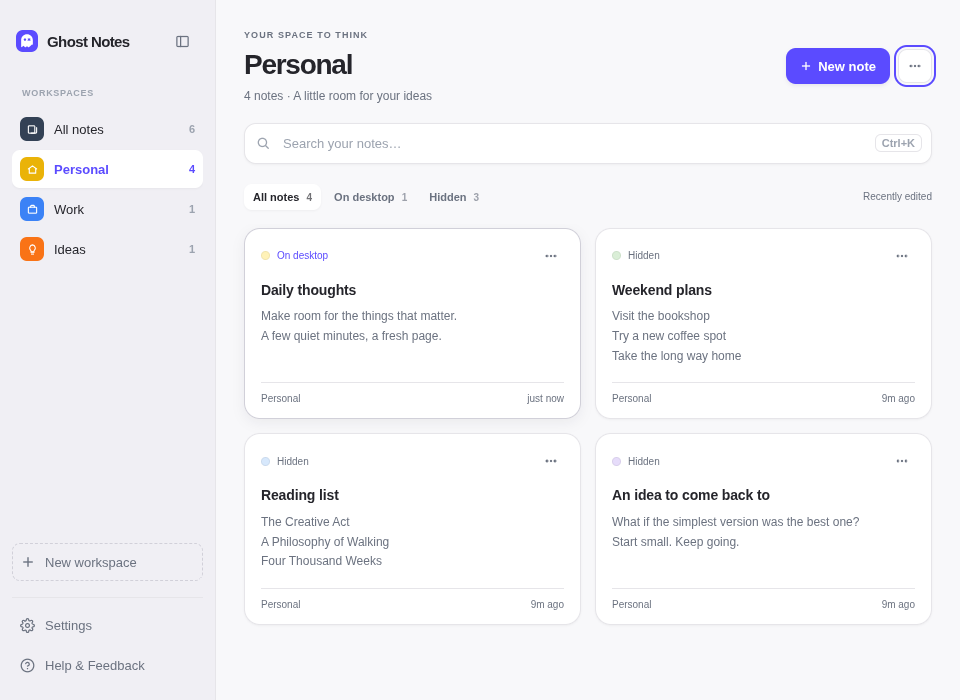

# Ghost Notes for Omarchy

Local sticky notes with rich text, workspaces, colors, opacity, pinning, and
click-through mode, with a Ghost Notes button in the Omarchy bar. The complete
Electron app is included as source in `app/`; this is more than a launcher for
an independently installed app.



**Capture exclusion is optional and version-specific.** The bar plugin and app
alone do not make notes invisible to recording. The included native companion
supports Hyprland **0.56.2** and must match the running compositor's exact build
hash. Google Meet, Zoom, and other recorders must be tested with their actual
capture path. Direct GPU/KMS recorders can still see the notes.

## Developers

- **Main developer — [Navya Bijoy](https://github.com/navyabijoy):** creator of Ghost Notes / Invisible Notes and the original application.
- **Co-developer — [Nandith (Nandith-0777)](https://github.com/Nandith-0777):** Linux/Hyprland integration, interface updates, shortcuts, and the Omarchy plugin.

## Current version — 0.1.0

The plugin bundles the Linux source update of Ghost Notes 1.2.2. This version includes:

- Redesigned Notes Manager with workspace navigation, search, note cards, and All notes / On desktop / Hidden filters.
- Clear note toolbars, a purple ghost icon with an active state, compact Aa and appearance controls, and light/dark themes.
- Smoother dragging and resizing, including scaled XWayland pointer handling.
- Centered note/workspace deletion dialogs; workspace deletion preserves notes.
- Four global shortcuts while the app runs in the tray. Users can type or record shortcuts, review before saving, reset defaults, and see conflict feedback. Each shortcut requires Ctrl, Alt, Shift, or Super plus another key.
- A friendly empty-note prompt: “A thought, a plan, a little reminder…”.
- Linux desktop/keychain integration and an optional exact-build Hyprland 0.56.2 capture/input companion, with the limitations described above.
- Regression tests and disposable-profile checks for the manager, formatting, resizing, pointer input, capture, and shortcuts.

See the [complete Linux change summary](app/README.md#current-linux-version--5-november-2026) and [local validation](VALIDATION.md). This source update does not publish new standalone app binaries. Marketplace submission is awaiting owner review and approval.

## Requirements

- Omarchy 4 / Quattro with the Omarchy shell and XWayland.
- Node.js 22.12 or newer, npm, Bash, and the standard `sha256sum` utility.
- Electron 43.6.0, installed from the pinned `runtime/package-lock.json` during
  the explicit setup step. Setup needs network access and downloads Electron.
- Electron's ordinary Linux runtime libraries, supplied by an Omarchy desktop.
- Optional capture companion: matching Hyprland development headers, a C++26
  compiler, pkg-config, pixman, libdrm, and xcb-shape development files.

## Install

After this repository has been published:

```sh
omarchy plugin add https://github.com/Nandith-0777/omarchy-ghost-notes --enable
bash ~/.config/omarchy/plugins/io.github.nandith-0777.ghost-notes/scripts/setup.sh
```

This plugin requires **manual setup** of the Electron runtime. No dependency
installation, configuration change, or app launch happens merely from loading
the bar widget. Clicking before setup shows a notification with the setup command.

The runtime lives outside the plugin checkout under
`${XDG_DATA_HOME:-~/.local/share}/ghost-notes/omarchy-runtime/<lockfile-sha256>`.
Dependencies therefore do not interfere with Omarchy's no-symlink plugin
validation. Run `bash scripts/setup.sh --check` to print its exact location.

For a local working copy, run `bash scripts/setup.sh`, then use
`bash scripts/launch.sh manager` or `bash scripts/launch.sh new`. Installing the
bar widget is optional; the bundled app can be tested directly this way.

## Use

- Click the ghost in the bar to open Notes Manager.
- Right-click it to create a note.
- Organize notes into workspaces and filter by All notes, On desktop, or Hidden.
- In Settings → Shortcuts, edit any action, type a combination or use Record keys,
  then save. Ctrl, Alt, Shift, and Super combinations with function keys,
  navigation keys, punctuation, and numpad keys are supported. Conflicts preserve
  the previous shortcut.
- In a floating note, use Aa for formatting and the sliders button for appearance.
- Global shortcuts while the app runs in the tray: Ctrl+Alt+Shift+N (new note),
  M (manager), H (hide/show), and G (click-through). Settings → Shortcuts shows
  conflicts and allows rebinding.
- Pin keeps a note above ordinary windows. The ghost button enables click-through;
  this is distinct from capture exclusion.

The app uses the existing Ghost Notes profile (`invisible-notes`). A previously
running Ghost Notes instance handles launches through its single-instance lock.
For isolated testing, set `GHOST_NOTES_DATA_DIR` to a disposable directory.

## Optional capture companion: expert setup

Read [the companion documentation](app/integrations/hyprland-capture/README.md)
and [Linux capture boundaries](app/LINUX.md) before enabling it. It is not a
universal Linux capture API. Do not bypass its version/hash guards.

On Hyprland 0.56.2, after reviewing the changes and closing Ghost Notes:

```sh
cd ~/.config/omarchy/plugins/io.github.nandith-0777.ghost-notes
bash app/scripts/build-capture-plugin.sh
runtime_dir=$(bash scripts/runtime-path.sh)
NODE_PATH="$runtime_dir/node_modules" node app/scripts/setup-linux.js --hyprland --capture-plugin
hyprctl reload
hyprctl configerrors
hyprctl ghostnotes:status -j
```

That **explicit** setup command creates/replaces the `ghost-notes` launcher and
desktop entry, writes `~/.config/hypr/ghost-notes.lua`, and adds its `dofile` line
to your Hyprland Lua configuration. Changed Hyprland files are backed up first.
If another Ghost Notes installation exists, preserve its launcher and desktop
entry before replacing them. Rebuild and revalidate after Hyprland updates.

The companion can affect capture of other windows carrying `no_screen_share`
and closing-animation snapshots. See its documentation for the exact boundaries.
Native pointer and capture hooks need explicit maintainer review.

## Update

```sh
omarchy plugin update io.github.nandith-0777.ghost-notes
bash ~/.config/omarchy/plugins/io.github.nandith-0777.ghost-notes/scripts/setup.sh
```

Quit and reopen Ghost Notes to use app changes. If you enabled the native
companion, close notes, rebuild it against the new compositor, and follow the
companion's unload/reload instructions before relying on exclusion again.

## Remove

Quit Ghost Notes first. If you never enabled the optional capture companion:

```sh
omarchy plugin remove io.github.nandith-0777.ghost-notes
```

No note database is deleted. To remove only downloaded runtimes, you may also
remove `${XDG_DATA_HOME:-~/.local/share}/ghost-notes/omarchy-runtime`; this is
separate from the `invisible-notes` profile. Keep that profile to keep your notes.

If you enabled the companion, **before removing the plugin checkout**:

1. Quit Ghost Notes so protected note windows are closed.
2. Remove only the Ghost Notes `dofile` line from `~/.config/hypr/hyprland.lua`,
   and remove `~/.config/hypr/ghost-notes.lua` if it belongs to this installation.
   Restore your pre-install backups if you had another Ghost Notes integration.
3. Unload this companion with `hyprctl plugin unload /absolute/path/to/app/dist/hyprland/ghost-notes-capture.so`.
4. Run `hyprctl reload` and `hyprctl configerrors`. Resolve errors before continuing.
5. Remove or restore `~/.local/bin/ghost-notes` and
   `~/.local/share/applications/com.invisiblenotes.app.desktop` only if they point
   into this checkout. Then remove the Omarchy plugin with the command above.

Do not delete unrelated configuration or the note profile.

## License and provenance

Apache-2.0. See [LICENSE](LICENSE) and [NOTICE](NOTICE). The bundled application is
derived from [Navya Bijoy's Invisible Notes](https://github.com/navyabijoy/invisible-notes)
with Navya Bijoy credited as the main developer and Nandith-0777 as co-developer for Linux/Hyprland, interface changes, and the Omarchy integration. Its original
license and attribution are retained. Dependency licenses are included in the
installed runtime's packages. The screenshot contains disposable sample notes.

## Validation

```sh
omarchy plugin validate .
bash -n scripts/*.sh
bash scripts/setup.sh --check
node --test test/*.test.cjs
```

The app's Node tests are in `app/test/`. Point `NODE_PATH` at the installed
runtime's `node_modules` when running `node --test app/test/*.test.js`.

The native companion has been tested on Hyprland 0.56.2 with disposable scenes,
including scaled/rotated capture and real pointer delivery. Those checks do not
establish that every recording or meeting app excludes notes.
